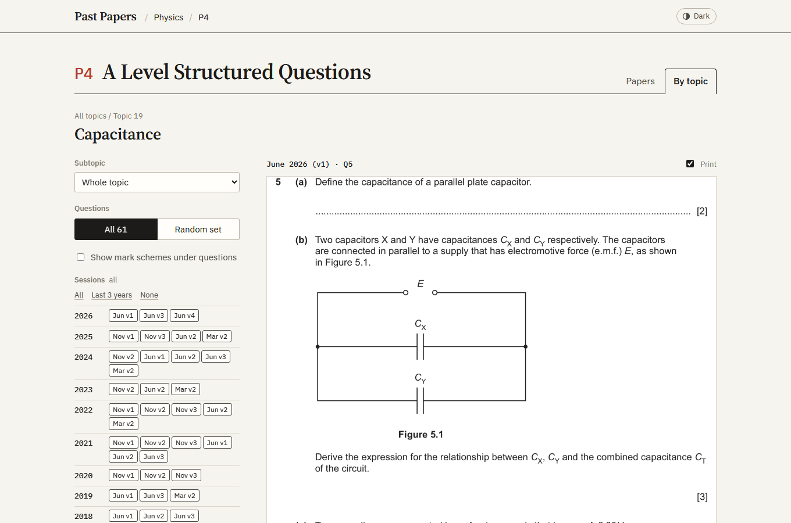

# Past Papers Archive

[](https://github.com/Tarmk/ALPapers/actions/workflows/ci.yml)


Every question paper and mark scheme for Edexcel IAL Mathematics (all 14 units, back to the legacy GCE units), CAIE Physics 9702 and CAIE Computer Science 9618, up to the June 2026 series. Every question is also cut out of its paper, filed under its syllabus topic, and can be read, filtered by session, turned into a random practice set and printed with its mark scheme in the same order.

**Live:** https://al-papers.vercel.app



## Features

- Subjects → papers → sessions, with links to every question paper and mark scheme, plus Paper 2 inserts and Paper 4 source files for computer science, and the previous specifications for maths.
- **By topic** for all 23 papers: about 14,000 questions, 98% with their mark scheme.
- All questions or a seeded random set; filter by session (grouped by year); show the mark scheme under each question; print the questions or the mark schemes on A4, in the same order.
- Every view has a shareable URL (`?subject=physics&paper=P4&view=topics&topic=19`), and back/forward work.
- Light and dark themes; in dark mode the scanned pages are inverted so they don't glare.

## How the topical data is made

`tools/topical/` builds it from the links in `src/data/subjects.ts` (details in its [README](tools/topical/README.md)):

1. **Fetch** every PDF and check each link serves what it says (three mark-scheme links that served question papers, and a misfiled M2 entry that was a C1 paper, were found and fixed this way).
2. **Clean** mirror watermarks out of the PDF content stream, so the page is exactly as published.
3. **Split** each paper at its question numbers and keep only the printed question: text, tables and diagrams, without answer lines, margins or page furniture. Mark schemes are split on their question column. The splitter copes with the IAL, legacy and Cambridge layouts, landscape schemes, fonts whose text layer is shifted, and Decision papers bundled after their answer book.
4. **Label** each question with its syllabus subtopic, from the full question text, following [`LABELLING.md`](tools/topical/LABELLING.md). A question whose parts test different topics is filed under each, with the parts named. Independent audits of random samples are used to check and correct the labels.
5. **Build** the indexes in `src/data/topical/`, checking that every image exists and every label is a real subtopic.

## Performance

Each paper's topical index is its own chunk, fetched only when that paper's "By topic" view opens, so the first page load stays small. The largest index (physics P1, about 4,700 questions) is 80 KB gzipped. Question images are 16-level greyscale PNGs of about 24 KB.

## Running it locally

```bash
npm install
npm run dev        # http://localhost:5173
npm run build      # type-check, then build to dist/
```

The repository also stores the question images and the older source PDFs (several GB). To work on the app without downloading them:

```bash
git clone --filter=blob:none --no-checkout https://github.com/Tarmk/ALPapers.git
cd ALPapers
git sparse-checkout set --no-cone '/*' '!/offline/' '!/public/topical/'
git checkout main
```

## Repository layout

| Path | What it is |
|------|------------|
| `src/App.tsx` | Page shell and routing |
| `src/components/` | Home, subject, paper and topical views |
| `src/data/subjects.ts` | Paper links for every subject, paper and session |
| `src/data/topical/` | One topical index per paper, plus `summary.json` with the counts |
| `public/topical/` | Question and mark-scheme images |
| `tools/topical/` | The pipeline that builds the topical data |
| `offline/` | Older source PDFs and extraction output (not needed to run the app) |

To add a paper, add its links to `src/data/subjects.ts`, then run the pipeline for that session (see `tools/topical/README.md`):

```typescript
"2026 June": {
  qp: "https://link-to-question-paper.pdf",
  ms: "https://link-to-mark-scheme.pdf",
},
```

## Tech

React 18, TypeScript (strict), Vite and plain CSS with custom properties for theming, hosted on Vercel. The pipeline is Python (PyMuPDF, Pillow) and Node. CI type-checks and builds on every push and reports the bundle sizes.

## License

The code is MIT licensed, see [LICENSE](LICENSE). The question papers and mark schemes are the copyright of their exam boards (Pearson Edexcel and Cambridge University Press & Assessment) and are not covered by that licence.
